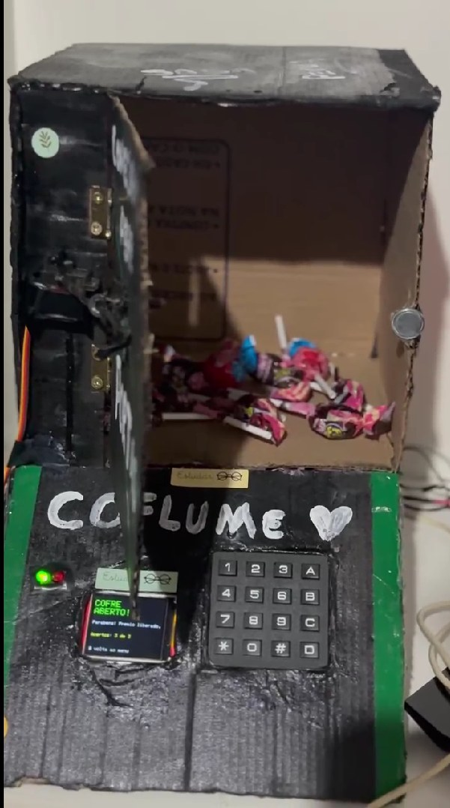

# Coflume — O Conhecimento Abre Portas

Cofre educacional interativo desenvolvido com **ESP32-S3**, combinando perguntas escolares, um mecanismo físico de abertura e uma rede neural para apoiar a adaptação da dificuldade durante o Quiz.

Projeto desenvolvido por **Sara Thais** e apresentado na **InovaTech 2026**.

**[Baixar a versão da InovaTech 2026](https://github.com/sarathais-tech/coflume/releases/tag/v0.9-r4-inovatech)** · [Guia de montagem](docs/guia_iniciantes.md) · [Guia de uso](docs/guia_de_uso.md) · [Guardiã IA](#como-funciona-a-guardiã-ia) · [Experimente a Guardiã](#experimente-a-guardiã-ia)

## Proposta educacional e público

O **Quiz é voltado principalmente para crianças**: a proposta é incentivar a participação e o contato com conteúdos de Matemática, Português, Lógica e Conhecimentos Gerais por meio de um desafio físico.

O banco da r4 contém **36 perguntas**, organizadas em três níveis: **Explorador, Desafiante e Mestre**. Esses nomes representam níveis internos do jogo, não uma classificação de idade, inteligência ou aprendizagem da criança. A adequação das perguntas à faixa etária ainda precisa ser avaliada com o público pretendido.

O **Agente Secreto** é uma modalidade complementar de raciocínio sob pressão, com pistas e uma missão de **90 segundos**. Pelo tempo curto, não tem o mesmo foco infantil do Quiz; sua adequação depende do participante.

## Modalidades

| Modalidade | Funcionamento | Participação da Guardiã |
|---|---|---|
| **Quiz** | O participante escolhe o nível inicial e responde a três perguntas, com até 30 segundos por pergunta e possibilidade de dica. Pelo menos **2 acertos em 3** liberam o cofre | Estima a chance de acerto para apoiar a escolha da dificuldade nas perguntas 2 e 3 |
| **Agente Secreto** | Pistas, música e cronômetro no painel do computador; senha digitada no teclado físico. A senha correta libera o cofre | A Guardiã não participa |

No Quiz, a alternativa correta vem do banco de questões. A contagem de acertos e o controle do servo seguem regras do programa.

## Como funciona a Guardiã IA

A Guardiã é uma rede neural **MLP com 13 entradas, 8 neurônios ocultos e 1 saída**, treinada previamente com **dados sintéticos**. O modelo exportado executa a previsão **offline no ESP32-S3**, sem depender de Wi-Fi ou servidor.

As entradas resumem o histórico da partida e a dificuldade candidata: acertos, tempo, uso de dicas, sequência de respostas, nível inicial e categoria. A rede não lê o enunciado e não gera perguntas.

| Componente | Responsabilidade |
|---|---|
| **Rede neural** | Estimar a probabilidade de acerto para cada dificuldade avaliada |
| **Política do jogo** | Escolher uma dificuldade permitida com estimativa próxima do alvo configurado de **70%**, considerando perguntas disponíveis |
| **Regra de desbloqueio** | Liberar o servo com pelo menos 2 acertos em 3, independentemente do valor previsto pela rede |
| **Painel e monitor da IA** | Receber dados pela USB e reproduzir o cálculo com os mesmos pesos, exibindo previsões, ativações e a explicação da escolha |

Na primeira pergunta, vale o nível escolhido no menu; a previsão é apenas registrada. Nas seguintes, a política utiliza as previsões da rede.

**A dificuldade se adapta, mas a rede não é treinada durante a partida:** os pesos permanecem fixos. O alvo de 70% é uma escolha de projeto, ainda sem validação de eficácia educacional.

Na r4, a configuração padrão usa **`fluxo-0.8`**, com IA adaptativa ligada e **proteção gradual experimental desligada**. A opção gradual e seu log de demonstração são configurações experimentais separadas.

| Onde encontrar | Conteúdo |
|---|---|
| [coflume-guardian](https://github.com/sarathais-tech/coflume-guardian) | Desenvolvimento da Guardiã e [passo a passo para reproduzir o treinamento e exportar o modelo](https://github.com/sarathais-tech/coflume-guardian/blob/main/docs/reproducao.md) |
| [Modelo embarcado](firmware/v0.9-r4/coflume_v09/guardia_modelo.h) | Pesos e parâmetros do modelo `mlp8-sint-20261101-e6a4cf00` usado na r4 |
| [Inferência no ESP32-S3](firmware/v0.9-r4/coflume_v09/guardia_runtime.h) | Código C++ que transforma as entradas em uma estimativa de acerto |
| [Monitor da Guardiã](firmware/v0.9-r4/painel/README.md#monitor-da-ia-dois-monitores) | Como abrir a segunda janela e acompanhar as decisões durante o Quiz |

## Experimente a Guardiã IA

### No computador, sem o cofre

1. Na [página da versão da InovaTech](https://github.com/sarathais-tech/coflume/releases/tag/v0.9-r4-inovatech), baixe **Source code (zip)** e extraia o arquivo.
2. Na pasta `firmware/v0.9-r4/painel/`, abra `Coflume_Agente_Secreto_USB.html` no Chrome ou Edge.
3. Em **Reproduzir log**, clique em **ABRIR ARQUIVO…** e escolha `demo/demo_fluxo08.txt` na pasta do painel.
4. Clique em **ABRIR MONITOR DA IA** para acompanhar a rede em uma janela separada. No painel principal, clique em **▶ REPRODUZIR** ou avance com **PRÓXIMO EVENTO**.
5. Acompanhe as chances de acerto por nível e a dificuldade escolhida para as perguntas 2 e 3. O aviso **DADOS DE DEMONSTRAÇÃO** identifica a reprodução de uma partida simulada.

### Ao vivo, com o ESP32-S3

1. Monte o cofre e grave o firmware seguindo o [guia de montagem](docs/guia_iniciantes.md).
2. Conecte o ESP32-S3 por USB e feche o Monitor Serial e o Plotter Serial do Arduino IDE para liberar a porta.
3. Abra o HTML no Chrome ou Edge, clique em **CONECTAR ESP32**, selecione a porta da placa e aguarde **COFRE PRONTO**.
4. Abra o **MONITOR DA IA** pelo painel e inicie um **Quiz** pelo teclado do cofre. Responda à primeira pergunta para acompanhar a escolha da dificuldade da segunda.

O [guia de uso](docs/guia_de_uso.md) traz os passos para exibir o monitor em uma segunda tela e usar os outros arquivos de demonstração.

## Hardware e painel

- **ESP32-S3 DevKitC-1 N16R8**.
- **Display TFT 1,8″ ST7735**, usado em paisagem, 160×128.
- **Teclado matricial 4×4**.
- **Servo real no GPIO 12**, alimentado por fonte externa com GND comum ao ESP32.
- **Painel HTML no computador**, conectado por USB, para o Agente Secreto, logs e visualização da IA.
- **Monitor da IA em janela separada**, que pode ser exibida em outra tela.
- **LEDs físicos:** vermelho no GPIO 13 e verde no GPIO 2.

As ativações mostradas no computador são **calculadas novamente no painel** e conferidas com a previsão enviada pela placa. Não são medições diretas das ativações internas do ESP32. A animação pode ser exibida em câmera lenta; ela não representa a duração real da inferência.

## Estado atual — 09/11/2026

**A r4 foi submetida a testes físicos funcionais**, com evidências e limites registrados no [relatório de testes](docs/testes/coflume-v0.9-r4.md).

| Verificação | Evidência disponível |
|---|---|
| Quiz com **0 e 1 acerto** | Logs com `desbloqueio=NAO`; servo fechado confirmado pela responsável |
| Quiz com **2 e 3 acertos** | Logs com `desbloqueio=SIM`; abertura do servo confirmada pela responsável |
| Três níveis iniciais, dicas e tempo esgotado | Registros das partidas; timeout contado como erro |
| Retorno após vitória | Fechamento do servo e retorno ao menu com **#**, confirmados manualmente |
| Guardiã e monitor ao vivo | Vídeo com USB conectada, atualização das perguntas e previsões reproduzidas marcadas como **confere** |
| Agente Secreto | Início automático, senha correta/incorreta, apagar entrada, cancelar e fim dos 90 segundos confirmados manualmente |
| Perda de conexão | Painel ausente, fechamento do painel durante a missão e avisos ao retirar a USB confirmados manualmente |
| Reabertura do monitor da IA | Continuidade do Quiz e recuperação da pergunta atual confirmadas manualmente |

Os logs acumulados reúnem **8 sessões distintas**. O autoteste registra **21 vetores, zero falhas** e correspondência do modelo. Há uma medição informativa de **8,13 µs por previsão**, em média de 1.000 chamadas na placa; ela **não substitui a bancada formal de latência**.

**Pendências:** registrar a linha completa de boot com versão e hash do banco; conferir as 36 perguntas na tela e as 16 teclas; verificar o mecanismo final, a estabilidade prolongada e os equipamentos da apresentação. O relatório detalha os casos parciais e as evidências disponíveis.

Os testes funcionais não representam validação integral do sistema. **O modelo continua experimental, sem validação com crianças ou comprovação de melhoria na aprendizagem.**

## Versões e código

O firmware e a documentação da r4 estão neste repositório. Para baixar o projeto, use **Code → Download ZIP**.

| Versão | Conteúdo |
|---|---|
| [v0.7 — Wokwi](simulations/wokwi/v0.7/sketch.ino) | Referência da simulação, com níveis fixos e sem Guardiã |
| [v0.8 — Wokwi experimental](simulations/wokwi/v0.8/README.md) | Integração inicial da Guardiã |
| [v0.9 — r2](firmware/v0.9/README.md) | Firmware físico com ST7735 e Agente Secreto USB |
| [v0.9 — r3](firmware/v0.9-r3/README.md) | Política gradual opcional, desligada por padrão |
| **[v0.9 — r4](firmware/v0.9-r4/README.md)** | Banco de 36 perguntas, painel da Guardiã e monitor da IA |

Para abrir o firmware atual no Arduino IDE, use **[`firmware/v0.9-r4/coflume_v09/coflume_v09.ino`](firmware/v0.9-r4/coflume_v09/coflume_v09.ino)**, mantendo todos os arquivos `.h` da pasta juntos.

O painel fica em **[`firmware/v0.9-r4/painel/Coflume_Agente_Secreto_USB.html`](firmware/v0.9-r4/painel/Coflume_Agente_Secreto_USB.html)**. Para conexão ao cofre, utilize um navegador compatível com Web Serial, como Chrome ou Edge. O [guia de uso](docs/guia_de_uso.md) descreve a conexão e a demonstração sem hardware.

## Guias e testes

- [Guia para iniciantes](docs/guia_iniciantes.md): componentes, alimentação, pinagem, montagem, bibliotecas, gravação e testes.
- [Guia de uso](docs/guia_de_uso.md): Quiz, Agente Secreto, música, USB, monitor da IA e reprodução de demonstrações.
- [Relatório de testes da r4](docs/testes/coflume-v0.9-r4.md): testes automatizados, vídeos, sessões físicas e pendências.
- [Pendências da montagem](docs/montagem_pendencias.md): fotos e informações ainda não documentadas.
- [Relatório v0.7](docs/testes/coflume-v0.7-wokwi.md) e [relatório v0.8](docs/testes/coflume-v0.8-wokwi.md): histórico da simulação.

## Executar a referência no Wokwi

Crie um projeto ESP32-S3 no [Wokwi](https://wokwi.com/) e copie os arquivos de `simulations/wokwi/v0.7/`:

- [Sketch](simulations/wokwi/v0.7/sketch.ino).
- [Diagrama](simulations/wokwi/v0.7/diagram.json).
- [Bibliotecas](simulations/wokwi/v0.7/libraries.txt).

A simulação v0.7 usa **ILI9341**; o hardware físico da v0.9 usa **ST7735**.

## Créditos

- **Desenvolvimento do Coflume:** Sara Thais.

